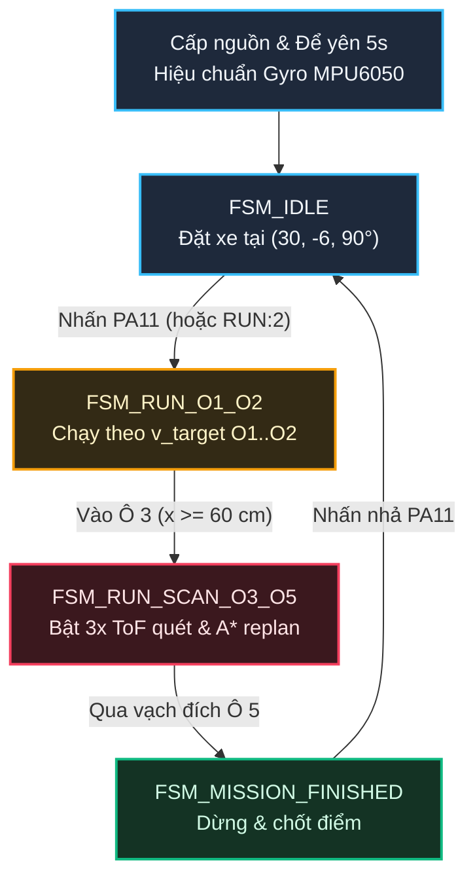

# 🤝 HỢP ĐỒNG TÍCH HỢP 2 NGƯỜI & HƯỚNG DẪN NẠP FIRMWARE
> **Dự án:** `Cheesy_Integrated_Firmware` (STM32F411CEU6 — 100 MHz, 512 KB Flash, 128 KB RAM)  
> **Mục tiêu:** Chạy **100% Tự Hành hợp nhất 1 chế độ duy nhất** (Lần 1 và Lần 2 chạy giống nhau: vào **Ô 3** là bật 3× VL53L0X quét map & né vật cản bằng A*, tốc độ tối đa **30 cm/s**, `v_target` hiệu chỉnh trực tiếp sau mỗi lần test), giữ nguyên BLE Telemetry (`$TEL`/`$EVT`) để theo dõi tọa độ EKF.

---

## 🏛️ 1. KIẾN TRÚC PHÂN TÁCH 2 NGƯỜI (ZERO CONFLICT)

```mermaid
flowchart LR
    classDef in fill:#1e293b,stroke:#38bdf8,stroke-width:2px,color:#f1f5f9;
    classDef proc fill:#332a15,stroke:#f59e0b,stroke-width:2px,color:#fef3c7;
    classDef dec fill:#3b181e,stroke:#f43f5e,stroke-width:2px,color:#ffe4e6;
    classDef out fill:#143324,stroke:#10b981,stroke-width:2px,color:#d1fae5;

    LL["Tầng Thấp (Core/)<br/>Code bạn của bạn"]:::in
    BR["Cầu Nối (Interface/)<br/>Hợp đồng 2 người"]:::proc
    EKF["EKF + Odometry<br/>Biết xe ở đâu"]:::proc
    MAP["3x ToF Mapper + A*<br/>Quét map từ Ô 3..Ô 5"]:::dec
    CTRL["Pure Pursuit + FSM<br/>Tự hành <= 30 cm/s"]:::out

    LL -- "Encoder, IMU, 3x ToF, Pin, PA11" --> BR
    BR -- "RobotSensorFrame_t (50Hz)" --> EKF
    EKF -- "RobotPose_t (x,y,theta)" --> MAP
    MAP -- "Waypoints C-Space" --> CTRL
    CTRL -- "RobotDriveCmd_t (v,w)" --> BR
    BR -- "rad/s (Slew + <=30cm/s)" --> LL
```



| Khu vực thư mục | Phụ trách chính | Phụ thuộc STM32 HAL? | Khi sửa có ảnh hưởng người kia không? |
| :--- | :--- | :---: | :--- |
| **`Core/`** (`motor_api.c`, `imu.c`, `vl53l0x.c`, `battery.c`, `ble_telemetry.c`, `main.c`) | **Bạn của bạn** (Tầng Thấp) | Có | **Không**, miễn giữ nguyên `g_m0`, `g_m1`, `g_imu`, `sensors[3]` |
| **`HighLevel/`** (`ekf_localization.c`, `arena_map.c`, `obstacle_mapper.c`, `astar_planner.c`, `pure_pursuit.c`, `mission_fsm.c`) | **Bạn** (Tầng Cao) | **Không** (100% C11 chuẩn) | **Không**, test & mô phỏng 2D trực tiếp trên PC bằng GCC |
| **`Interface/`** (`robot_interface.h`, `robot_hw_bridge.c`) + `Core/Src/app.c` | **Trao đổi chung** | Chỉ `robot_hw_bridge.c` | Chỉ chạm vào khi đổi cấu trúc gói dữ liệu `RobotSensorFrame_t` / `RobotDriveCmd_t` |

---

## ⚙️ 2. BẢNG THAM SỐ ĐÃ ĐỒNG BỘ PHẦN CỨNG THỰC TẾ (`HighLevel/Inc/robot_config.h`)

| Tham số | Giá trị đã đồng bộ | Nguồn đối chiếu `[OBSERVED]` | Ghi chú tinh chỉnh |
| :--- | :---: | :--- | :--- |
| `ROBOT_WHEEL_DIAM_CM` | **`4.50 cm`** | `test_cheesy/app.c` (`0.045 m`) & `auto_nav.py` | Đo lại đường kính ngoài lốp nếu thay bánh |
| `ROBOT_TRACK_WIDTH_CM` | **`9.60 cm`** | `test_cheesy/app.c` (`0.096 m`) & thước kẹp `114.6 mm` phủ bì | Chỉnh nếu xe quay 90° bị dư/thiếu góc |
| `ROBOT_ENCODER_PPR` | **`2800.0`** | `test_cheesy/app.c` & `motor_api.c` (TIM2/TIM3 4x) | 1 vòng bánh = 2800 xung (`0.00505 cm/xung`) |
| `ROBOT_MAX_SPEED_CMS` | **`30.0 cm/s`** | Yêu cầu vận tốc tối đa ~30 (`13.33 rad/s`) | Bão hòa tỉ lệ 2 bánh bảo toàn độ cong `<= 30 cm/s` |
| `V_TARGET_O1..O5_CMS` | **`20 / 18 / 26 / 17 / 24`** | `HighLevel/Inc/robot_config.h` | Tốc độ mặc định từng đoạn Ô 1..Ô 5 (giống nhau mọi lần chạy) |
| `g_m0_kp / g_m0_ki` | **`200.0 / 0.0`** | `test_cheesy/app.c` (giữ nguyên mặc định bạn bạn) | Nếu chạy thực tế hụt tốc độ xác lập, bạn bạn tăng `Ki` lên `1.5 .. 4.0` |
| `PA2 / PA3` | **`USART2` (BLE)** | `cheesy.ioc` (khác schematic cũ từng vẽ IR) | **Không** cấu hình PA2/PA3 làm GPIO TCRT để tránh hỏng BLE |
| `TIM2 / TIM3` | **Encoder L / R** | `PA0/PA1` (L, thuận), `PB4/PB5` (R, đảo chiều) | Đọc atomic snapshot qua `total_ticks` (không reset tranh với TIM10 100Hz) |
| `I2C1 / I2C2` | **3x ToF / MPU6050** | ToF `0x54` (+45° L), `0x56` (0° F), `0x58` (-45° R); IMU `0x68` | Chạy 400 kHz; IMU tự lấy mẫu 200Hz + tự hồi phục bus I2C |

---

## 🎮 3. VẬN HÀNH TRÊN SÂN THI (1 CHẾ ĐỘ DUY NHẤT — TỪ Ô 3 BẬT ToF)



### Quy ước điều khiển nhanh
1. **Khởi động (5 giây đầu):** Đặt xe đứng yên trên sàn phẳng tại vạch xuất phát `(X = 30cm, Y = -6cm, mũi xe hướng thẳng +Y)` để `IMU_CalibrateGyro` lấy offset không bị rung.
2. **Nút `PA11` trên xe (giống nhau cho cả Lần 1 và Lần 2):**
   - **Nhấn `PA11` tại `IDLE`:** Xe chạy tự hành luôn 1 mạch từ Ô 1 ➔ Ô 2 ➔ đến **Ô 3 (`x >= 60 cm`) tự động bật 3× VL53L0X quét map + A* né vật cản** ➔ về đích Ô 5 (`FSM_MISSION_FINISHED`).
   - **Nhấn nhả `PA11` tại `FINISHED` hoặc `E_STOP`:** Reset sạch EKF/Map về `FSM_IDLE` để đặt xe chạy tiếp lần sau (**vẫn giữ nguyên `v_target` bạn vừa tinh chỉnh!**).
   - **Nhấn giữ (`>= 1.2s`) khi đang chạy:** Dừng khẩn cấp (`FSM_EMERGENCY_STOP`).
3. **3 cách hiệu chỉnh vận tốc mong muốn `v_target` sau mỗi lần chạy test (`[10..30] cm/s`):**
   - **Cách 1 (Sửa cố định trong code):** Chỉnh 5 hằng số `V_TARGET_O1_CMS .. V_TARGET_O5_CMS` trong `HighLevel/Inc/robot_config.h` rồi build nạp lại.
   - **Cách 2 (Chỉnh live không cần nạp lại qua BLE `USART2`):**
     - `VSEG:0,22` ➔ Đặt đồng nhất tất cả 5 đoạn thành `22 cm/s`.
     - `VSEG:3,28` ➔ Chỉnh riêng đoạn **Ô 3** (`1..5` tương ứng Ô 1..Ô 5) thành `28 cm/s`. *(Giữ nguyên qua các lần bấm `PA11` reset, chỉ về mặc định khi tắt nguồn).*
   - **Cách 3 (Chỉnh live qua STM32CubeMonitor):** Đổi trực tiếp mảng `g_v_target_cms[0..4]` trong `Core/Src/app.c`.
4. **Giám sát BLE tùy chọn (`USART2` 9600 baud):**
   - Xe tự phát `$TEL,mode,vbat,x,y,heading,dl,df,dr,...` (tọa độ `x, y, heading` là **đầu ra EKF thật**!).
   - Lệnh hỗ trợ: `RUN:2` (chạy tự hành, `RUN:3` làm bí danh tương đương), `RUN:1` (lái tay test motor), `VSEG:<0..5>,<v_cms>`, `STOP` (phanh khẩn cấp), `ZERO` (reset EKF & IMU về gốc xuất phát), `OBS:4,<1..5>` / `OBS:3,1` (nạp sẵn vị trí cọc test).

---

## 🛠️ 4. BIÊN DỊCH, KIỂM THỬ & NẠP XUỐNG STM32F411CEU6

### A. Chạy bộ kiểm thử & mô phỏng 2D vòng kín trên PC (GCC)
```powershell
cd "c:\New folder\01_Embedded\He_Thong_Nhung_EmbeddedSystems\Baicuoiki\Cheesy_Integrated_Firmware"
.\Tests\run_host_tests.ps1
```

### B. Biên dịch file firmware nạp vào STM32F411CEU6 (`.elf`, `.bin`, `.hex`)
```powershell
cd "c:\New folder\01_Embedded\He_Thong_Nhung_EmbeddedSystems\Baicuoiki\Cheesy_Integrated_Firmware"
.\build_firmware.ps1 -Preset Release
```
File sẵn sàng nạp (bằng STM32CubeProgrammer / ST-Link Utility / OpenOCD tại địa chỉ `0x08000000`):
- `build/Release/cheesy_integrated.bin`
- `build/Release/cheesy_integrated.hex`
- `build/Release/cheesy_integrated.elf`

---

## 📋 5. CHECKLIST KIỂM TRA TRƯỚC KHI ĐẶT LÊN SÂN THẬT
- [ ] **Kiểm tra chiều Encoder & Motor:** Gửi `RUN:1`, sau đó `DRV:150,0,1000` (chạy thẳng 15 cm/s trong 1s) ➔ kiểm tra `$TEL` xem `y` tăng `+15 cm` và `x ≈ 30 cm`.
- [ ] **Kiểm tra chiều Gyro Yaw:** Xoay xe ngược chiều kim đồng hồ (trái) 90° bằng tay ➔ kiểm tra `heading` trong `$TEL` tăng từ `90°` lên `180°`. Nếu bị đảo dấu, đặt `g_imu.yaw_invert = 1;` trong `imu_config()` (`Core/Src/app.c`).
- [ ] **Kiểm tra 3x VL53L0X:** Đưa tay lần lượt trước cảm biến Trái / Trước / Phải ➔ kiểm tra `dl`, `df`, `dr` trong `$TEL` giảm đúng vị trí (không bị tráo trái/phải).
- [ ] **Kiểm tra lực kéo Motor PI:** Nếu xe chạy chậm hơn vận tốc đặt (vì `Ki = 0`), bạn của bạn tăng dần `g_m0_ki = g_m1_ki = 2.0f` trong `Core/Src/app.c` rồi kiểm tra qua CubeMonitor.
